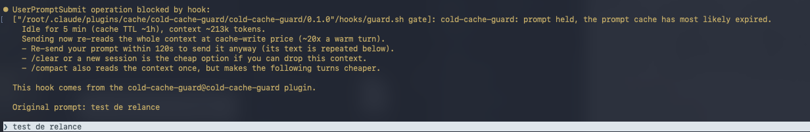
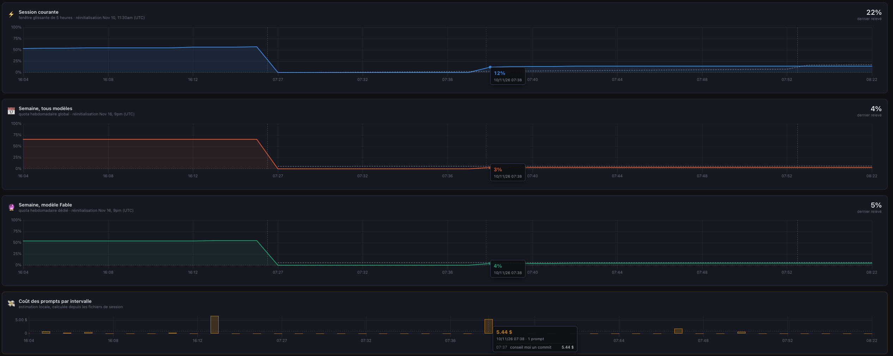

# Cold Cache Guard

Cold Cache Guard is a Claude Code plugin that saves your tokens and usage limits by detecting when your prompt cache has expired. Before you send a prompt on a large, idle or resumed session, it warns you that the full context will be reprocessed, so you can /compact first or confirm.

[](https://github.com/aleblanc/cold-cache-guard/actions/workflows/ci.yml)




The prompt is not lost: Claude Code puts it back in the input, so pressing Enter again sends it.

## The problem

A real case. A Claude Code session (Fable model, ~845k tokens of context) is left open in the
evening, around 16:15. The next morning at 07:37, the first prompt sent in that session is a trivial
one: "suggest a commit message". That single prompt moves the 5-hour session quota from **0 % to
12 %**, plus 3-4 % of the weekly quotas, for an estimated **$5.44**.



The prompt was only a few words long. The cost came from the context: after a night of inactivity
the prompt cache had expired, so the whole 845k-token history was processed again at cache-write
price.

Claude Code sends the whole conversation history on every turn. The prompt cache normally makes this
cheap, but only while the cache is warm:

| Operation                 | Price, relative to base input |
|---------------------------|-------------------------------|
| Cache read (warm turn)    | 0.1x                          |
| Cache write, 5-minute TTL | 1.25x                         |
| Cache write, 1-hour TTL   | 2x                            |

When the cache has expired, the whole context is written to the cache again. With the 1-hour TTL a
cold turn costs about **20 times** a warm turn (2x vs 0.1x), and about 12 times with the 5-minute
TTL. On a large context that is a big share of your usage limits for one message, and nothing in
the UI tells you before you press Enter.

### How long does the cache live?

| Where                                                    | Cache TTL |
|----------------------------------------------------------|-----------|
| Subscription (Pro/Max), main conversation, within plan usage | 1 hour |
| API key, usage credits, cloud providers                  | 5 minutes |
| Subagents, compaction, title generation                  | 5 minutes |

You can change it with the `promptCacheTtl` setting (`"5m"` or `"1h"`) or the
`CLAUDE_CODE_PROMPT_CACHE_TTL`, `ENABLE_PROMPT_CACHING_1H` and `FORCE_PROMPT_CACHING_5M`
environment variables. See the [prompt caching documentation](https://code.claude.com/docs/en/prompt-caching).

On a subscription, any prompt sent after more than one hour of inactivity on a large session is
expensive. Each cache read refreshes the TTL, so the clock starts at the end of Claude's last
response, not when you sent your last prompt.

## How it works

The plugin is two hooks and a bash script. It has no skill and no model involvement, so the check
runs before anything is sent to the API.

| Hook               | Mode   | What it does |
|--------------------|--------|--------------|
| `UserPromptSubmit` | `gate` | Checks idle time and context size. Holds the prompt once when the cache is likely cold and the context is large; otherwise records the activity. |
| `Stop`             | `log`  | Records when Claude finished responding (the moment the cache was last refreshed) and the context size. |

When a prompt is held:

- nothing is sent to Claude and nothing is billed;
- the warning is shown to you, and Claude Code puts your prompt back in the input;
- pressing Enter again within 2 minutes confirms it and lets it through;
- `/compact` and `/clear` are never held.

Where the data comes from:

- **Context size**: the latest main-conversation entry with `message.usage` in the session transcript
  (`input_tokens + cache_read_input_tokens + cache_creation_input_tokens`), or the post-compaction
  size after a `/compact`.
- **Last activity**: the latest of the `Stop` hook timestamp and the last response in the transcript.
  A session resumed right after you install the plugin is checked as well.
- **Cache TTL**: detected from the last cache write in the transcript (`ephemeral_1h_input_tokens` vs
  `ephemeral_5m_input_tokens`), then from `FORCE_PROMPT_CACHING_5M` / `CLAUDE_CODE_PROMPT_CACHE_TTL`,
  then 1 hour. The alert threshold is 55 minutes for a 1-hour TTL and 4 minutes for a 5-minute TTL.

`--resume` and `--continue` keep the session id, so the state is found again.

## Installation

Requirements: `bash` and [`jq`](https://jqlang.org/download/). Without `jq` the plugin does nothing
and never blocks.

```text
/plugin marketplace add aleblanc/cold-cache-guard
/plugin install cold-cache-guard@cold-cache-guard
/reload-plugins
```

From the command line:

```bash
claude plugin marketplace add aleblanc/cold-cache-guard
claude plugin install cold-cache-guard@cold-cache-guard
```

### Team deployment

Add the marketplace and enable the plugin in the project's `.claude/settings.json`:

```json
{
  "extraKnownMarketplaces": {
    "cold-cache-guard": {
      "source": { "source": "github", "repo": "aleblanc/cold-cache-guard" }
    }
  },
  "enabledPlugins": {
    "cold-cache-guard@cold-cache-guard": true
  }
}
```

Team members are offered the marketplace when they trust the project folder. Depending on your Claude
Code version, a project-level `enabledPlugins` entry may not download the plugin by itself: each
member then runs `claude plugin install cold-cache-guard@cold-cache-guard --scope project` once. See
the [plugin installation documentation](https://code.claude.com/docs/en/plugins/install).

## Configuration

All settings are environment variables. Set them in your shell or in the `env` block of
`settings.json`.

| Variable                  | Default                 | Description |
|---------------------------|-------------------------|-------------|
| `COLD_GUARD_IDLE_MIN`     | auto: `55` or `4`       | Minutes of inactivity before the alert. Auto is 55 (a margin under the 1-hour TTL) or 4 when a 5-minute TTL is detected. |
| `COLD_GUARD_MIN_TOKENS`   | `100000`                | No alert below this context size. |
| `COLD_GUARD_ACK_SEC`      | `120`                   | Confirmation window: re-send within this many seconds to send anyway. |
| `COLD_GUARD_DIR`          | `~/.claude/cold-guard`  | State directory. In Docker, point it to a volume. |
| `COLD_GUARD_HISTORY_DAYS` | `30`                    | Retention of `history.jsonl` and of per-session state files. |
| `COLD_GUARD_DISABLE`      | empty                   | `1` disables the plugin completely. |

Example in `~/.claude/settings.json`:

```json
{
  "env": {
    "COLD_GUARD_MIN_TOKENS": "200000",
    "COLD_GUARD_ACK_SEC": "300"
  }
}
```

## Statistics

```text
/cold-cache-guard:stats
```

```text
cold-cache-guard statistics (last 30 days, ~/.claude/cold-guard/history.jsonl)
  Sessions tracked:          14
  Responses logged:          612
  Context size (avg / max):  187k / 845k tokens
  Cold-cache alerts:         6
    confirmed (sent anyway): 2
    avoided (not re-sent):   4 (~2.1M tokens not reprocessed)
  Earliest event:            2026-10-12T07:41:03Z
```

The stats command is a prompt like any other, so it is subject to the same cold-cache cost on an idle
session. To read the report without a model turn, run the script directly:

```bash
~/.claude/plugins/cache/cold-cache-guard/cold-cache-guard/<version>/hooks/guard.sh stats
```

"Avoided" counts alerts that were not confirmed within the confirmation window (you compacted,
cleared, or left). It is an estimate.

## FAQ

**I use the API (or usage credits), not a subscription.**
Your main conversation uses the 5-minute TTL by default. The plugin detects it from the transcript
and alerts after 4 minutes of inactivity. If that is too noisy, raise `COLD_GUARD_IDLE_MIN` or
`COLD_GUARD_MIN_TOKENS`.

**What about subagents?**
Subagents always use a 5-minute cache and run inside a turn. The plugin only checks the prompts you
type in the main conversation.

**Does a held prompt cost anything?**
No. A blocked prompt never reaches Claude.

**Is `/compact` free?**
No. Compaction reads the whole context once, at cache-write price if the cache is cold. It makes the
following turns cheaper. `/clear` or a new session is the only free option, if you can drop the
context.

**Docker / dev containers?**
The script only depends on `bash`, `jq` and standard tools (`date`, `tail`, `mv`, `find`). It uses
`$HOME`, then `$TMPDIR`. Point `COLD_GUARD_DIR` to a mounted volume so the state survives container
restarts.

**How do I turn it off for one session?**
Start Claude Code with `COLD_GUARD_DISABLE=1 claude`.

**Does it read my prompts?**
It reads the first characters of the prompt only to let `/compact` and `/clear` through. Nothing
from the prompt is stored. The state files contain timestamps, session ids and token counts.

## Known limitations

- It is a heuristic. The plugin cannot query the actual cache state: the cache can be evicted earlier
  than its TTL, and switching models or MCP servers also invalidates it. Claude Code ≥ v2.1.251 shows
  a "Prompt cache (main)" line with the hit rate (and the cause of the last miss from v2.1.260), which
  you can use to cross-check.
- Any prompt sent within the confirmation window confirms, not only the same text.
- The context size recorded by the `Stop` hook can lag one turn, because Claude Code writes the
  transcript asynchronously. The gate reads the transcript again before deciding, so the alert is
  not affected; only the statistics are.
- The session quota window ("Session: x% - reset") is not exposed to hooks and is not used.
- In headless mode (`claude -p`), a held prompt prints the warning and the process still exits 0,
  so a script that resumes an idle session silently does nothing. Set `COLD_GUARD_DISABLE=1` for
  scripted and CI runs.
- `~/.claude/cold-guard` is not removed when you uninstall the plugin.

## Development

```bash
claude --plugin-dir .            # load the plugin from the working copy
/reload-plugins                  # after a change

COLD_GUARD_IDLE_MIN=1 COLD_GUARD_MIN_TOKENS=1 claude --plugin-dir .   # trigger the alert quickly

bats tests/                      # tests (bats-core)
shellcheck hooks/guard.sh
claude plugin validate . --strict
```

The script is fail-open: any error (missing `jq`, unreadable transcript, invalid JSON, unwritable
state directory) ends with exit 0. Keep it that way: a bug in this plugin must never prevent someone
from sending a prompt.

### Releasing

The project follows git-flow: work happens on `develop` and feature branches, releases are merged
into `main` and tagged there.

1. Bump `version` in `.claude-plugin/plugin.json` (Claude Code uses it to detect updates).
2. Move the `[Unreleased]` entries of `CHANGELOG.md` under the new version and date.
3. Merge into `main`, tag `vX.Y.Z` and push the tag.

## Contributing

Issues and pull requests are welcome. Please add a bats test for any behavior change and keep the
script compatible with bash 3.2 (macOS) and with Linux.

Related discussion: [anthropics/claude-code#38029](https://github.com/anthropics/claude-code/issues/38029).

## License

[MIT](LICENSE)
